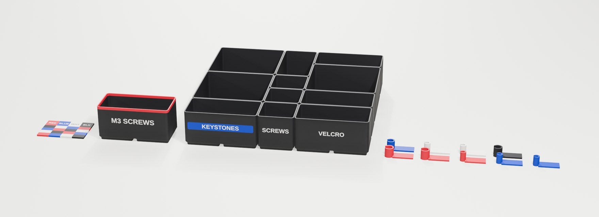
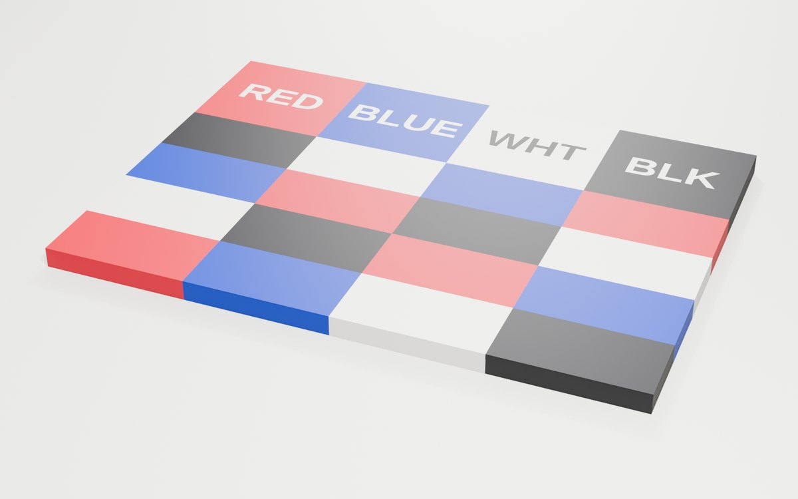
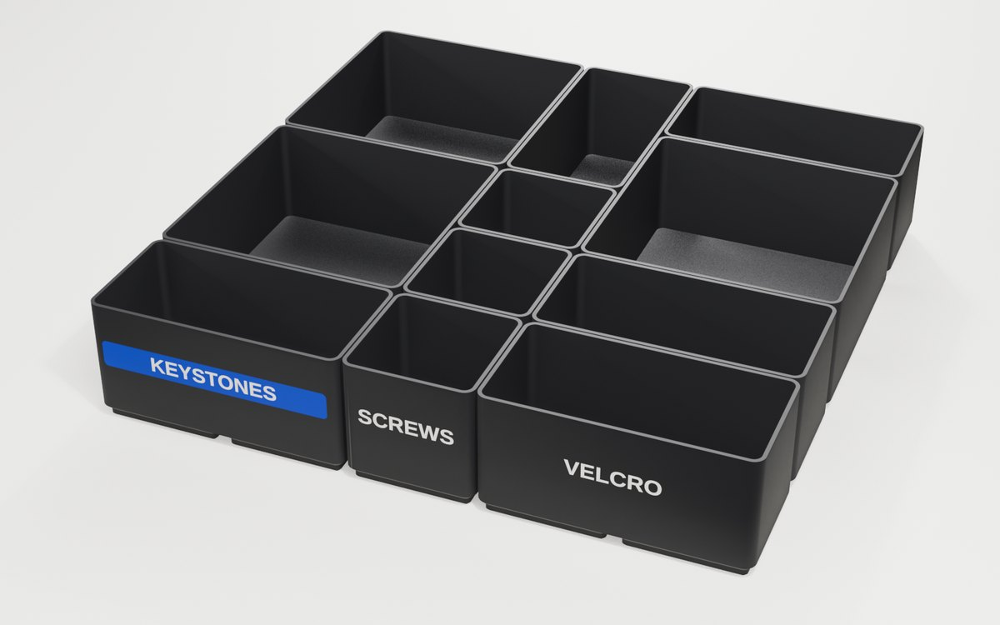
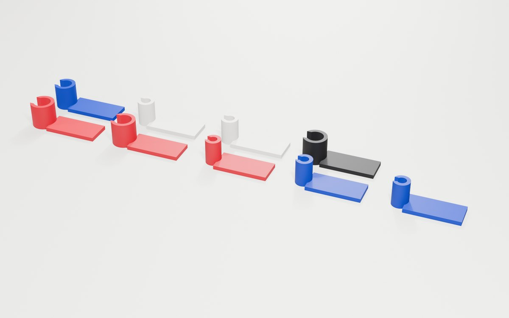
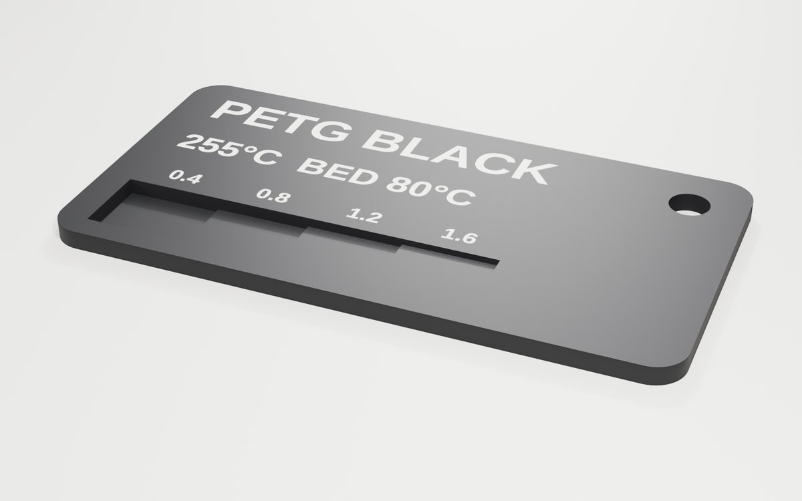
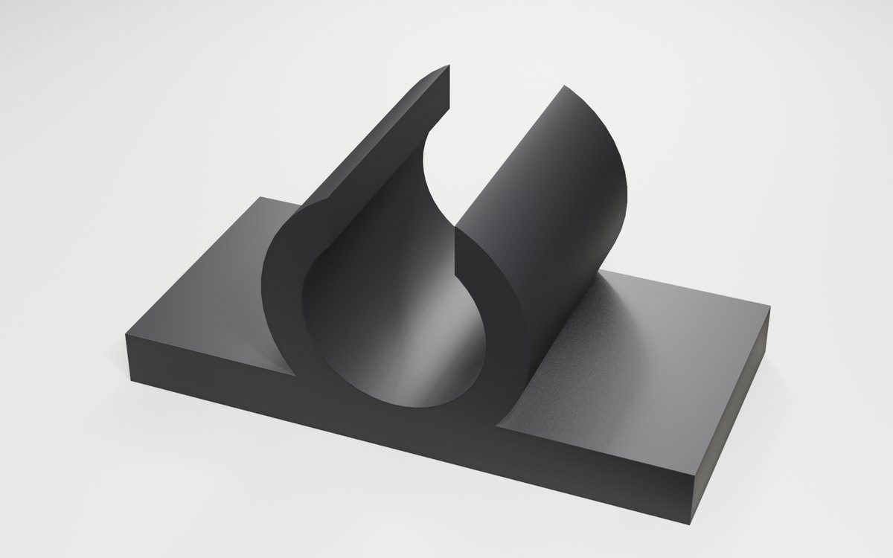
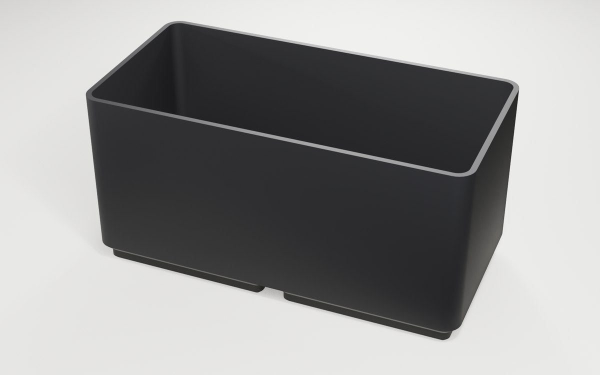
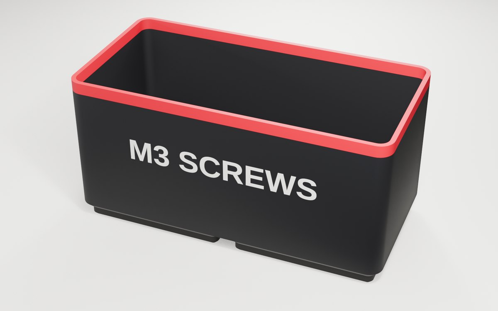

# Claude 3D printing



**Design and upgrade 3D prints by talking to Claude Code.** Describe a part, or hand over an STL you downloaded. Claude writes it in OpenSCAD with every size as a named number, exports one print file per colour, checks the meshes, and shows everything on a page you can turn round on your phone, with the sizes drawn on, before a gram of filament is used.

[**Live demo**](https://kalmehdar.github.io/claude-3d-printing/) · [Start in a minute](#start-in-a-minute) · [What to ask Claude](#ask-claude) · [Upgrade a print you already have](#upgrade-a-print-you-already-have) · [Add your own design](CONTRIBUTING.md)

## Start in a minute

1. Install [Claude Code](https://claude.com/claude-code) and [OpenSCAD](https://openscad.org/downloads.html) (take a development snapshot: much faster).
2. Copy the skills and agents into Claude:

   ```bash
   git clone https://github.com/kalmehdar/claude-3d-printing.git
   mkdir -p ~/.claude/skills ~/.claude/agents
   cp -R claude-3d-printing/skills/* ~/.claude/skills/
   cp claude-3d-printing/agents/*.md ~/.claude/agents/
   ```

3. Restart Claude Code in an empty folder and ask: *"Design a Gridfinity bin, 2 x 1, 42 mm tall, for M3 screws, with the label printed in white. My printer is a Bambu A1 with the AMS."*

Claude asks anything it needs (your printer, caliper numbers for parts that must fit), then hands back the print files, a checked mesh, a Print Bench page and which file goes on which head.

## Examples

Every example is on the [live demo](https://kalmehdar.github.io/claude-3d-printing/) in 3D with its source and STLs to download.

| | | |
| --- | --- | --- |
|  |  |  |
| Four-colour test card | Colour-coded Gridfinity bins | Cable tags, each clip sized to its cable |
|  |  | |
| Filament swatch card with a see-through step strip | Desk cable clip, sized to your cable | |
|  |  | |
| Before: a plain downloaded STL | After: Claude added a label, a red rim and magnet pockets | |

These pictures come from `tools/render.py`, from the same files you can download.

## What's here

| Path | What it does |
| --- | --- |
| `tools/export_parts.py` | Exports each colour part of an OpenSCAD model to its own STL and checks it fits your bed |
| `tools/mesh_audit.py` | Runs inside Blender: non-manifold edges, inside-out meshes, pieces, thin walls, bed fit |
| `tools/print_bench.py` | Builds the Print Bench page from a `bench.json`: one HTML file with the 3D viewer, size lines, a measure tool and download links |
| `tools/render.py` | Runs inside Blender: a studio picture of every design in its print colours, or all of them in one line-up (`--lineup`), for READMEs and posts |
| `.github/workflows/pages.yml` | Rebuilds the Print Bench page and publishes it on GitHub Pages on every push |
| `examples/models/` | Five designs (a four-colour test card, colour-coded Gridfinity bins, clip-on cable tags sized per cable, a filament swatch card, a desk cable clip) and `upgrade-bin.scad`, which upgrades an existing STL |
| `examples/before/` | The plain STL that `upgrade-bin.scad` starts from |
| `examples/stl/`, `examples/bench.json` | Their exported parts and the demo page's list |
| `skills/` | Claude Code skills: `print-workflow` (drives these tools from idea or STL to checked, previewed print files), `3d-print-designer` (FDM design rules, materials, verification) plus `modeling`, `blender`, `blender-3d-modeling`, `texturing`, `asset-optimization`, `animation`, `rigging`, `unity`, `vroid`, `omniverse` |
| `agents/` | Seven 3D subagents (analyst, modeler, texturer, rigger, animator, asset optimiser, VTuber specialist) |

## Full setup

1. Install [OpenSCAD](https://openscad.org/downloads.html). Take a development snapshot: it renders with the manifold backend, seconds instead of minutes.
2. Install [Blender](https://www.blender.org/download/) for the mesh check (optional, but it catches problems early).
3. Install your printer maker's slicer (Bambu Studio, OrcaSlicer, PrusaSlicer, Snapmaker Orca).
4. Copy the skills and agents into Claude as in [Start in a minute](#start-in-a-minute). On Windows, Git Bash runs the same commands.

## Ask Claude

With the skills installed, open Claude Code in a folder where you want the files and ask in plain words. The `print-workflow` skill runs the tools for you: model, export, mesh check, Print Bench, and a short hand-over with which file goes on which head.

- "Design a Gridfinity bin, 2 x 1, 42 mm tall, for M3 screws, with the label printed in white. My printer is a Bambu A1 with the AMS."
- "Here's an STL I downloaded. Add a printed-in label on the front and magnet pockets in the base."
- "This phone stand is 2 mm too tight for my case. The case measures 11.4 mm. Fix the slot."
- "Make this part print in two colours: the top 3 mm in red."
- "Show me everything I've designed so far on a Print Bench, with renders for my README."

Give Claude caliper numbers for anything that has to fit. It never guesses a fit size; it marks those `FIT` and asks.

## Try it

```bash
cd claude-3d-printing/examples
python ../tools/export_parts.py models/test-card.scad --out stl --bed 256x256x256
blender --background --factory-startup --python ../tools/mesh_audit.py -- stl --bed 256
python ../tools/print_bench.py bench.json print-bench.html
```

Open `print-bench.html` in a browser. For pictures:

```bash
blender --background --factory-startup --python ../tools/render.py -- bench.json renders
```

 To share it, fork this repo, set Settings, Pages, Source to "GitHub Actions", and point the `download` URL in `bench.json` at your fork: every push rebuilds your page.

Set `OPENSCAD` to the binary if it isn't on your PATH. A model lists its colour parts on its first line (`// parts: red blue white black`); each becomes `<model>-<part>.stl`. In the slicer, load all of a model's parts as one object and give each part its own head.

## Upgrade a print you already have

Most prints start as someone else's STL. Claude can improve one without the original source file: OpenSCAD's `import()` loads the STL as a solid, and three operations do the rest. `difference()` cuts into it, `union()` adds to it, `intersection()` pulls a region out so it can print in another colour. `examples/models/upgrade-bin.scad` does all three to a plain bin in about 30 lines. In the demo, compare "before" and "after".

Things to ask for:

| Upgrade | How Claude does it |
| --- | --- |
| A label printed into it | A 0.6 mm text pocket cut into a face; the same text, clipped to the part, becomes a second-colour STL that fills it |
| A second colour on a part that has one | `intersection()` with a slab or shape takes that region out as its own STL; `difference()` removes it from the body |
| A better fit | Grow or shrink a hole by cutting a new cylinder through it; `resize()` or `scale()` in one axis for a part that is a few percent off |
| Magnets, screws, heat-set inserts | Pockets cut at measured positions (magnet size plus 0.2 mm clearance) |
| Mount it somewhere | `union()` a hook, a Skadis peg, a screw tab or a Gridfinity foot onto it |
| Stronger | Fill a thin wall, or add a rib along the part that snapped |
| Too big for your bed | Cut it into pieces with `intersection()`, and add a dovetail or alignment pins at the joint |
| Broken mesh | Run `mesh_audit.py`. If it is non-manifold, re-export it from Blender's 3D Print Toolbox, or have Claude rebuild the part in OpenSCAD from measurements |

How to ask: give Claude the STL, say what is wrong with it or what you want added, and give caliper numbers for anything it has to fit. Claude reads the STL's size and bounds first (`export_parts.py` and `mesh_audit.py` both print them), writes the upgrade with each position as a named number, exports the parts, audits them, and adds a before and after to your Print Bench. For bigger changes it is often cleaner to have Claude redraw the part in OpenSCAD from measurements, which makes every later change one number.

Check the licence first. Many models on Printables, MakerWorld and Thingiverse allow remixes for personal use only (CC BY-NC); credit the original in anything you share.

## The way I work with Claude

- Ask for a part with its job and its numbers. "A bin for 10 USB sticks, 42 mm Gridfinity grid, label USB printed into the front."
- Never let Claude guess a fit size. Anything that clips onto, slides into or screws to something real needs a caliper number. Claude marks those `FIT` and you measure before printing.
- Labels are printed in, not stuck on. A 0.6 mm pocket in the body, the letters in a second colour filling it, printed face down.
- One colour per head, one STL per colour. The `part` variable picks which colour a run of OpenSCAD draws.
- Check before slicing. `mesh_audit.py` must say 0 files need a fix. Squares that touch only at a corner are the usual non-manifold culprit; overlap them by 0.01 mm.
- Look at it first. Rebuild the Print Bench and turn the model round on your phone before you print.

## First-week tips

From DIY WISCO's [10 Things I Wish I Knew Before I Started 3D Printing](https://youtu.be/fetbc62jeWI), in my words, plus what four colours taught us:

- Start with PLA. PETG when it needs to take heat; ABS and ASA want an enclosure and real ventilation.
- Use the slicer's own profiles. The maker's slicer, your printer, your filament, default settings, until a few prints succeed.
- A print that won't stick usually means a dirty plate. Wash it with dish soap and warm water, dry it fully, hold it by the edges. Glue stick if that fails.
- Watch the first layer, then walk away. Even lines that are stuck down mean the rest will probably go fine. Check on it by camera if you have one.
- Dry your filament. Popping at the nozzle, sudden stringing or a rough surface mean wet filament. PETG soaks it up faster than PLA, and new sealed spools can still be wet.
- Supports only where needed. Tree supports come off more easily.
- The time estimate is a guide. Expect it to run over.
- For models, try MakerWorld, Printables, Thingiverse. Pick ones with photos of real prints.
- For several colours, print the test card first. A four-colour plate needs room for the prime tower, so a set that fills the bed splits into two plates.

## Licence

The tools and example designs are MIT (see `LICENSE`). Each skill and the agents keep their own licence, in their folder; `SOURCES.md` lists where each came from.

More of my Claude Code setup: [claude-kit](https://github.com/kalmehdar/claude-kit).
