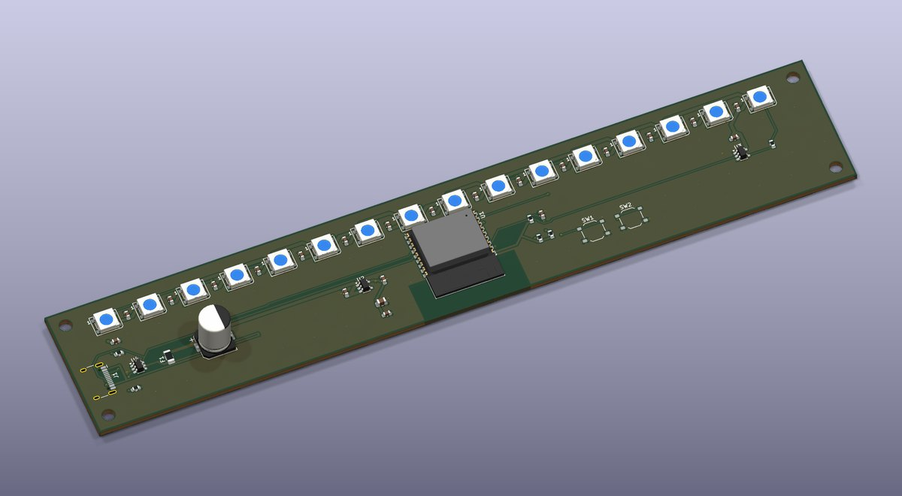
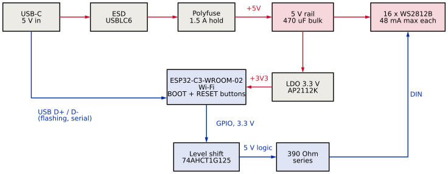

# Rack status LED bar



A 1U panel for a 10-inch rack: 16 addressable LEDs and an ESP32-C3 on one board, behind a printed faceplate with a white diffuser window. Powered and flashed over one USB-C cable, and runs [WLED](https://kno.wled.ge/), so it's controlled from a phone or Home Assistant.

Designed end to end with Claude Code: the specs, the circuit, the board layout, the routing, the checks, the order files and the faceplate. **Not built yet.** Before ordering, a person works through [REVIEW.md](REVIEW.md).

| File | What it is |
| --- | --- |
| [SPECS.md](SPECS.md) | What it does, the power budget, every part with its datasheet and LCSC number |
| [overview.svg](overview.svg) | The circuit as blocks: power along the top, data below |
| `circuit.py` | The circuit as code (SKiDL). Its electrical rules check passes with 0 errors |
| `layout.py`, `board.json` | Where every part sits, the board rules and the power track widths |
| `led-bar.kicad_pcb`, `led-bar.kicad_pro` | The KiCad board: open it in KiCad 10 to look or change things |
| `fab/` | Ready to order: `led-bar-gerbers.zip`, `led-bar-bom-jlcpcb.csv`, `led-bar-cpl-jlcpcb.csv`, plus STEP and STL models and renders |
| `case.scad`, `stl/` | The printed 1U faceplate and diffuser, built from the board's own numbers (`board_dims.scad`) |
| [REVIEW.md](REVIEW.md) | The checklist a person ticks before ordering |



## Rebuild it

Needs KiCad 10, Java 25 and [Freerouting](https://github.com/freerouting/freerouting/releases) (see the main README).

```bash
python tools/pcb.py all hardware/led-bar
```

That runs the circuit's rules check, places the parts, autoroutes, runs KiCad's design-rules check (last run: 0 errors, 0 unconnected, 0 warnings), writes every fab file and the case dimensions. Then export the faceplate:

```bash
python tools/export_parts.py hardware/led-bar/case.scad --out hardware/led-bar/stl --bed 270x270x270
```

The faceplate is 254 mm wide, so it needs a printer bed of 255 mm or more.

## Order and build

1. Work through REVIEW.md in KiCad.
2. Upload `fab/led-bar-gerbers.zip` to JLCPCB (2 layers, 1.6 mm), choose top-side assembly, then upload the BOM and CPL files. All the parts are in JLCPCB's stock list; the passives are Basic parts.
3. Print the faceplate face down: `case-panel` in black PETG, `case-diffuser` in white PETG on a second head. Fix the board to the standoffs with four M3 x 6 self-tapping screws.
4. Plug in USB-C, open [install.wled.me](https://install.wled.me) in Chrome or Edge, and flash WLED.
5. In WLED: LED Preferences, data GPIO **4**, 16 LEDs, type WS281x. Set the brightness limiter to **400 mA** on a laptop USB port, or **1400 mA** on a 2 A or better USB-C charger.

## What Claude got wrong on the way (kept so the skills learn)

- SKiDL calls its no-connect net `__NOCONNECT`; the board builder first treated it as a real net and joined every unused pin together. Caught by reading the DRC, fixed in `tools/pcb_kicad.py`.
- KiCad 7 and later keep net classes in the project file. Until the builder wrote `.kicad_pro`, the router never saw the wide power tracks.
- The first module choice (ESP32-C3-MINI-1) is marked not recommended for new designs and has no KiCad library footprint; the board uses the WROOM-02 instead.
